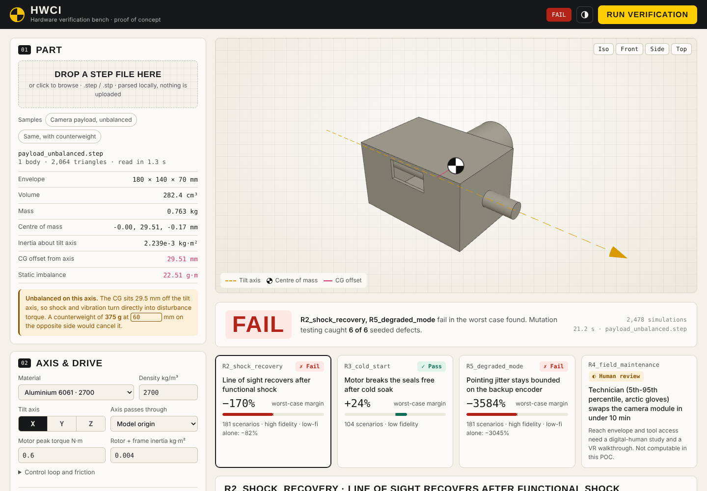
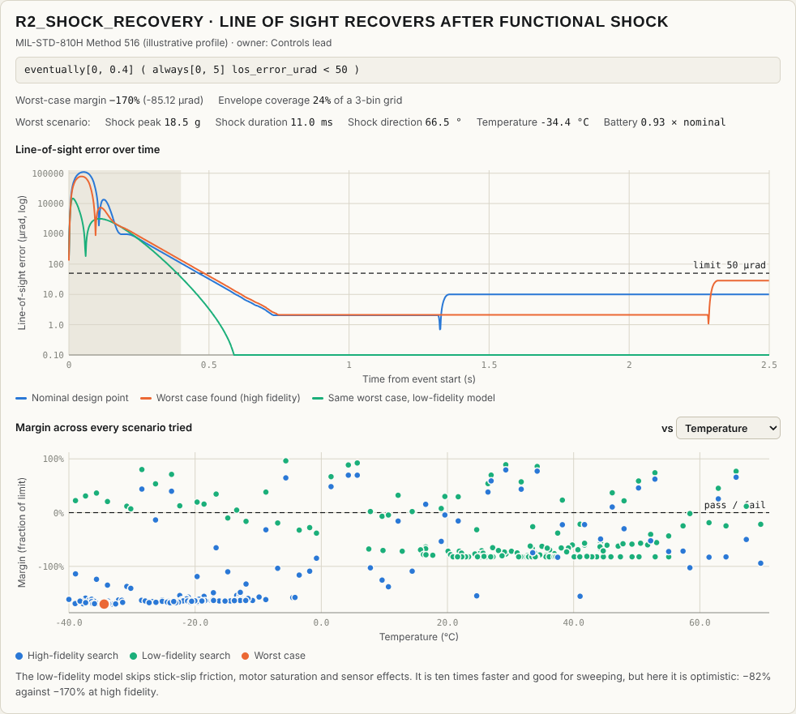

# HWCI — CI for hardware (proof of concept)

Load a STEP part, write requirements as executable formulas, and let a
worst-case search try to break the design. The same engine runs in the
browser and in a GitHub Actions job, so every change to a part can be
re-verified automatically, the way software is.



## What it does

1. **Part.** The STEP file is read in the browser with OpenCascade (WebAssembly).
   Mass, centre of mass and inertia about the tilt axis are computed from the
   geometry and the chosen material. Nothing is uploaded anywhere.
2. **Model.** Those properties drive a single-axis gimbal model: motor with torque
   limit, PID loop re-tuned for the actual inertia, cold-dependent stick-slip
   friction, encoder noise, shock and platform vibration. A CG offset from the axis
   becomes disturbance torque.
3. **Requirements.** Each requirement is a Signal Temporal Logic formula plus a
   scenario envelope, for example
   `eventually[0, 0.4] ( always[0, 5] los_error_urad < 50 )` over shock 18–22 g,
   −40 to +71 °C, battery 80–100 %. Results are margins, not just pass/fail.
4. **Search.** For each requirement, a Latin-hypercube sweep plus Nelder-Mead
   refinement looks for the scenario with the smallest margin. Shock requirements
   are also searched with a fast low-fidelity model, to show what a
   surrogate-only check would have concluded.
5. **Mutation testing.** Six seeded defects (worn bearings, firmware regression,
   undersized motor, CG shift, wrong tuning, noisy backup encoder) check whether
   the requirement set would notice. Survivors point to gaps in the requirements.

Two sample parts are included: a camera payload whose CG sits 29.5 mm off the
tilt axis (fails), and the same payload with a counterweight (passes).



## Run it locally

The app is static HTML/JS with no build step, but browsers block WebAssembly
and module workers on `file://`, so serve the folder over HTTP:

```bash
python -m http.server 8000        # or: npx serve .
# open http://localhost:8000
```

Deep link that loads a sample: `http://localhost:8000/?sample=payload_unbalanced.step`

## Put it on GitHub

```bash
git init -b main            # skip if the folder is already a repository
git add .
git commit -m "HWCI proof of concept"
git remote add origin https://github.com/<you>/<repo>.git
git push -u origin main
```

Then, in the repository: **Settings → Pages → Source: GitHub Actions**. The
`Deploy to GitHub Pages` workflow publishes the app at
`https://<you>.github.io/<repo>/`.

Uploading through the GitHub web page also works: drag the folder contents
into "Add file → Upload files". The `.github` folder is hidden on some systems;
make sure it is included, or the workflows will be missing.

## Hardware CI from the command line

```bash
node tools/hwci.mjs samples/payload_balanced.step
node tools/hwci.mjs my_part.step --requirements my_reqs.yaml --material ti64 --axis y --json result.json
```

Exit code 0 means every computable requirement passes its worst case, 1 means
a failure. Results are deterministic: the same inputs give the same numbers in
the browser and in the CLI.

The `Hardware CI` workflow (`.github/workflows/hardware-ci.yml`) runs this on
every push that touches a STEP file. Edit `PARTS` and `REQUIREMENTS` at the top
of the workflow to point at your own files.

## Requirement format

```yaml
requirements:
  - id: R2_shock_recovery
    title: Line of sight recovers after functional shock
    source: MIL-STD-810H Method 516 (illustrative profile)
    owner: Controls lead
    model: shock_response            # or cold_start
    formula: "eventually[0, 0.4] ( always[0, 5] los_error_urad < 50 )"
    threshold: 50                    # margins are reported as a fraction of this
    nominal:  {shock_g: 20, shock_ms: 11, axis_deg: 90, temp_c: 20, battery: 1.0}
    envelope:                        # the search space, [min, max]
      shock_g:  [18, 22]
      temp_c:   [-40, 71]
    fidelity: {escalate_below: 0.5}  # >0: search at high fidelity

  - id: R4_field_maintenance
    title: Technician swaps the camera module in under 10 min
    kind: human_review               # flagged, never auto-passed
    reason: Needs a digital-human study.
```

Formula operators: `always[a,b]`, `eventually[a,b]`, `and`, `or`, `not`,
and comparisons `< <= > >=` against a number. Time bounds are seconds.

| Model | Signals | Scenario parameters |
|---|---|---|
| `shock_response` | `los_error_urad`, `motor_torque` | `shock_g`, `shock_ms`, `axis_deg`, `temp_c`, `battery`, `encoder_a_failed`, `base_vib_grms`, `seed` |
| `cold_start` | `torque_ratio`, `temp_c` | `temp_c`, `battery` |

## Project layout

| Path | Contents |
|---|---|
| `index.html`, `css/`, `js/app.js` | Web app |
| `js/step-worker.js` | STEP import in a Web Worker (occt-import-js) |
| `js/massprops.js` | Volume, CG and inertia from the triangulated solid |
| `js/design.js` | Mass properties + drive settings → model parameters, gain tuning |
| `js/engine/` | STL evaluator, gimbal model, oracle, worst-case search, mutation testing, suite runner |
| `tools/hwci.mjs` | Command-line runner for CI |
| `tools/make_samples.py` | Regenerates the sample STEP files (build123d) |
| `tests/` | `npm test`: STL vs brute force, JS vs Python parity, mass properties vs OpenCascade |
| `python/` | Reference engine in Python with an HTML report demo |
| `vendor/` | three.js, occt-import-js, js-yaml (see `vendor/README.md` for licenses) |

## Tests

```bash
npm test
```

- Temporal-logic robustness against a brute-force evaluator on 300 random formulas
- JavaScript model against the Python reference engine on fixed scenarios
- Mass properties from the browser mesh against OpenCascade's exact values
  (volume within 0.3 %, CG within 0.15 mm, inertia within 0.5 %)

## Limits of this proof of concept

- The gimbal model and every default number are illustrative, not a product
  specification. A production version would replace `js/engine/plant.js` with
  adapters to real solvers (FMI/FMU co-simulation, FEA, multibody).
- One material per part. Assemblies with mixed materials need per-body densities.
- Coverage is a simple binned measure without risk weighting.
- Requirements are written by hand. Drafting them from a SOW or a standard,
  for engineer approval, is a natural next step.

No license file is included yet; choose one before making the repository public.
Vendored libraries keep their own licenses (MIT and LGPL-2.1, see `vendor/README.md`).
